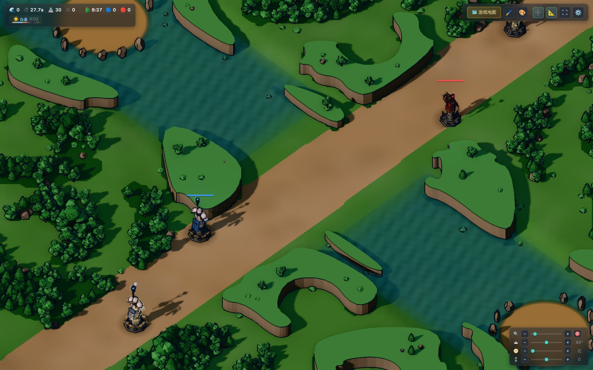
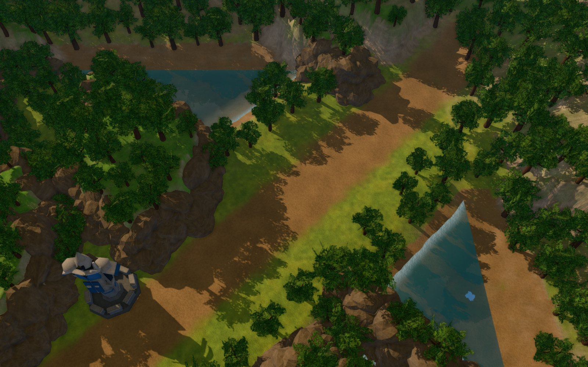
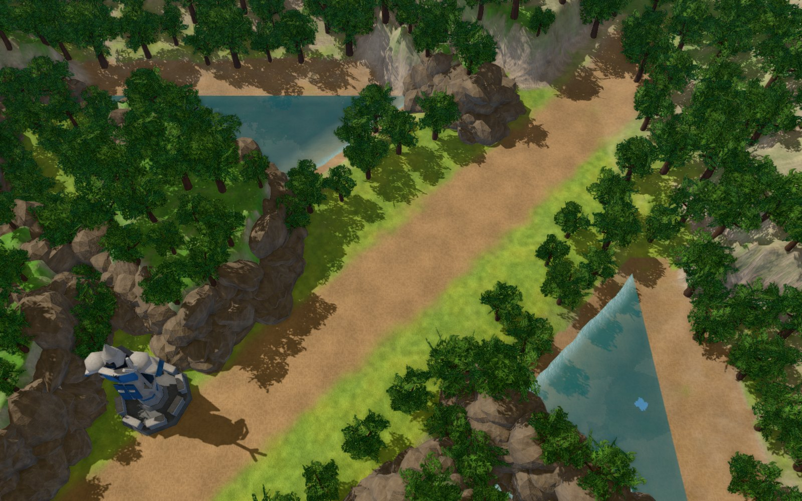

# 画面重构报告：从卡通到写实高清（参考 LoL / Dota2）

> 状态：**报告阶段，尚未动代码**。阶段 0（看图定方向）的原型做完会把截图补进 §10。
> 发起：用户 2026-11-10 "我想要特别真实高清的画面而不是这种卡通的画面……可能需要重做全部的地图和模型，
> 显示效果可以参考 lol 或者是 dota2……新版的地图我不要那种有边界的……不要仅是 2 维平面的，我要精美的地图"。

---

## 1. 现状诊断：卡通感从哪来

对着 LoL（2014 版之后的召唤师峡谷）和 Dota2（7.x 地图）逐项比，卡通感来自七个来源。
每一项都是当初按 Thronefall 风格（`docs/refs/thronefall/`）**刻意**做的，所以不是调参数能解决的：

| # | 现状（`src/presentation/`） | 造成的观感 |
|---|---|---|
| 1 | 所有模型是代码拼的低多边形 + 顶点色 + 硬切面（`UnitMeshFactory.js`、`minionModel.js`、`dragonModel.js`），没有任何贴图 | 塑料玩具感；近看没有材质信息 |
| 2 | 地面是一张画出来的 2D 画布贴图（`TerrainLayer.js` + `TerrainMaterial.js`）铺在几乎平的面上；野区墙是 2D 轮廓挤出的柱体（`WallLayer.js`），顶面平 | "贴纸铺在桌上"，没有真实起伏 |
| 3 | 植被是实例化的低多边形球和锥（`VegetationLayer.js`） | 棒棒糖树 |
| 4 | 光照 = 半球光 + 一盏方向光；地面 Lambert；没有环境光（IBL） | 平涂，材质对光没有响应 |
| 5 | 描边后处理（`PostFX.js` 的 OutlinePass） | 卡通渲染的招牌 |
| 6 | **正交相机**（`ThreeRenderer.js`，`CAM_DIST = 20000`） | 没有透视，远近一样大，像摆在桌上的模型 |
| 7 | 地图硬边 + 裙边（`MapSkirtLayer.js`、`TerrainEdgeLayer.js`） | "纸片、浮空" |

**结论：表现层整体重做。** 前几轮已经把逻辑层和表现层彻底分开（逻辑不 import 表现、`src/simulation.js` 的
独立 `step()`、100+ 套无头测试），所以玩法 / 数值 / 编辑器 / 测试基本不动，重做的是 `src/presentation/`
（41 个文件，约 1.6 万行）和全部美术资源。

---

## 2. 目标画面（预期效果）

基准：**Dota2 的写实度 + LoL 的清晰可读性**。做完之后每个元素应该是这样：

**镜头**：透视相机，俯仰 55–60°，视野角约 45°。近处小兵有透视缩放，远处略小。这一项就能去掉一半的"模型感"。

**地形**：真正的三维高度场。
- 四个高度层：河床最低（水面下沉）→ 兵线路面 → 野区高一截 → 基地高地最高；之间是坡道和台阶。
- 野区墙是**真实岩壁**：有厚度、有悬垂、有裂缝，顶上长树和苔藓；不是挤出的柱子。
- 地表 4–6 层 PBR 材质混合（草、泥路、岩石、苔藓、沙、河床卵石），每层带法线 + 粗糙度，近看有颗粒和凹凸；
  路面是踩出来的泥土，与草地自然过渡；岩壁三向投影贴图，不拉伸。
- 龙坑、男爵坑是真正下沉的坑，有坡道。

**水**：反射（天空、岸边）、折射（看得到河床）、岸边泡沫、按深度变色、流动法线；雨点涟漪保留。

**地图边界（用户特别强调的两条）**
- **没有边**：可玩区域之外地形继续向外延伸至少一个屏幕，并逐渐**升高**成山崖和密林（LoL 峡谷四周是山壁和森林，
  Dota2 是树林 + 雾）。相机移动范围限制在可玩区内，**永远看不到地形的尽头**；再加大气雾，远处融进天光。
  整个世界是一个"碗"，边缘向上，俯视角看不到天空和地平线，不存在"浮空"。
- **不是 2D 平面**：高度差是真实几何，影子、遮挡、透视都会体现。

**光照**：太阳（跟昼夜走）+ 天空环境光（IBL）+ 级联阴影（近处清晰、远处柔和）+ SSAO/GTAO + 物理泛光（只有真正亮
的东西发光：水晶、技能）+ 色调映射 + 调色 LUT + 大气透视。夜晚保留，塔和水晶是真正的光源。

**建筑**：带 PBR 贴图的高精度模型（石材风化、金属包边、发光符文），损毁三档有真实裂缝和缺块，倒塌有碎块和烟尘。

**单位**：带骨骼的模型（待机 / 行走 / 攻击 / 死亡），蓝红阵营各自配色，Dota2 式比例，不做血腥。

**植被**：树冠是带透明贴图的叶片簇（不是实心球），树皮贴图，风吹摆动；灌木、草丛、蕨类、石头、倒木，密度足够让野区读作"森林"。

**特效**：弹道 / 命中 / 光束 / 天气粒子全部用贴图粒子 + 发光材质重做；天气落地（铺沙 / 积雪 / 湿地）保留，按新材质系统做。

---

## 3. 平台评估：继续用浏览器（HTML + WebGL），还是换原生引擎

用户问："如果用 html 在以后的开发中是否有瓶颈，性能是否可以跟得上"。这里如实评估。

### 3.1 浏览器（three.js + WebGL2，现状路线）

**上限在哪（这些是硬的）**
- WebGL2 ≈ OpenGL ES 3.0：没有 compute shader、没有 mesh shader、没有 bindless、每个着色器最多 16 张贴图。
  影响：GPU 蒙皮动画和粒子不能用 compute 做，要用顶点动画贴图（VAT）和变换反馈这类绕法；复杂的 GPU 剔除做不了。
- 绘制调用开销比原生高 3–5 倍：一帧预算约 **1500–2500 次 draw call**（原生引擎可以 1 万+）。影响：一切必须实例化。
- JS 单线程：仿真和渲染在同一线程（Worker 可以跑仿真，但渲染只能主线程）。现在的仿真每帧预算机制已经在处理这件事。
- 显存不可控、不可查询：集成显卡上贴图太多直接掉帧或上下文丢失。影响：贴图必须走 KTX2 压缩，总量要有预算。
- 没有硬件光追；阴影只能做到级联 PCF/PCSS；体积光 / 体积雾只能做屏幕空间近似。
- 不能做"烘焙光照 + 光照探针"这类离线管线（能做，但要自己写工具）。

**能做到什么**
- 写实 PBR 材质、IBL、级联阴影、SSAO、泛光、色调映射、屏幕空间反射（简版）、贴图粒子、LOD、几百个带动画的实例化
  单位——这些在 WebGL2 里都是成熟做法（three.js / Babylon.js 的写实演示、Unity WebGL 导出的游戏都是这一档）。
- 以"**Dota2 的观感**"为目标，在 1080p、中档独显上 60 帧，**可以做到**，前提是从第一天就按预算做（§7）。
  要是目标是"Dota2 2024 逐帧一样"（体积雾、全局光照、超高面数角色），浏览器做不到，原生引擎才行。

**未来的出路**：WebGPU。Chrome / Edge 已稳定，Firefox / Safari 2025 起陆续跟上；three.js r169 已有 WebGPURenderer，
但后处理生态还在换代。路线上先 WebGL2，渲染层接口设计时留出换 WebGPU 的余地（材质用 three 标准材质、不手写 GLSL 到处散落）。

### 3.2 原生引擎（Unity / Unreal / Godot）

**优势**：编辑器、资源管线、光照烘焙、导航网格、动画状态机、粒子编辑器、地形雕刻全部现成；画面上限远高于浏览器；
没有 draw call / 显存焦虑。

**代价**
- **整个游戏重写**，不只是表现层：逻辑层是 JS，要改成 C# / C++ / GDScript；100+ 套测试、Config 软编码体系、
  模板编辑器、地图编辑器全部重做。前几轮的工作里能直接搬过去的只有"设计"，不是代码。
- 开发方式改变：我在这个环境里**不能运行 Unity / Unreal**（没有安装条件，也没有 GPU），也就不能像现在这样
  自己启动游戏、截图、无头跑测试再交付。每一步都要你在本地跑了告诉我结果——这几轮的工作节奏（我实机过一遍再交）就没了。
  Godot 勉强可以无头跑，但渲染截图同样需要 GPU，而且上面说的"整个重写"照样成立。
- 你要安装和维护引擎、构建、分发；浏览器"打开 index.html 就能玩"的便利没了。

### 3.3 中间路线

- **Electron / Tauri 套壳**：同一份网页代码跑在桌面窗口里，可以开 WebGPU 的实验标志、读本地文件。画面上限和浏览器一样，
  只是分发方式变了。以后想做再套，不影响现在。
- **Babylon.js 替换 three.js**：同一档位，自带的引擎功能更多（CSM、PBR、节点材质编辑器），但上限一样，且现有 1.6 万行
  表现层本来就要重写，换库没有额外收益。

### 3.4 结论与建议

**留在浏览器（three.js，WebGL2 起步，为 WebGPU 留口），理由按重要程度：**
1. 真正的瓶颈是**美术资源**（§5），不是平台。没有写实的贴图和模型，换什么引擎都是卡通。
2. 以 LoL / Dota2 的"观感"为目标，WebGL2 够用；做不到的只是最顶级的几项（体积光、全局光照），它们不是这个游戏的核心。
3. 全部逻辑、测试、编辑器都在这里，而且我能在这个环境里实机跑、截图、验收——这是这几轮能稳定交付的原因。
4. 以后要桌面版，套 Electron 即可，不用现在决定。

**明确接受的代价**：draw call 和显存要从第一天就按 §7 的预算管；阴影和 AO 的质量有上限；单位动画走 VAT 而不是
GPU 蒙皮。如果阶段 0–2 做出来你觉得上限不够，那时再谈换引擎，损失的只是表现层的工作。

---

## 4. 技术路线（新表现层）

**保留**：纯 JS + three.js r169、无构建步骤、全部逻辑层、Config / 编辑器 / 测试体系。

**新增 vendored 的 three 附件**：级联阴影 CSM、DRACO + KTX2 解码器（压缩模型和贴图）、Sky（程序化天空）、
PMREMGenerator（内置）、GLTFLoader（已有）。

**结构**
- **相机**：PerspectiveCamera，俯仰 55–60°，FOV 45°，可微调缩放；移动范围钳制在可玩区；取消旋转（透视 + 手工摆放的
  地图在固定朝向下才有最好的构图，LoL / Dota 也不给旋转）。旋转的代码留开关，默认关。
- **地形系统**（替换 TerrainLayer / TerrainMaterial / WallLayer / TerrainEdgeLayer / MapSkirtLayer）：
  高度图（PNG，16 位）+ 材质混合图（RGBA 两张 = 8 层）+ 悬崖 / 岩石网格（实例化的岩块按崖线摆）+ 水面网格 +
  延伸世界（可玩区外 1.5–2 倍范围、逐渐升高、雾化）。地形网格按视距分块 LOD。
- **地图数据**：从"代码画画布"改成资源文件：`assets/maps/<id>/height.png`、`splat.png`、`props.json`（道具摆放）。
  导航网格仍由逻辑层的 navgrid 决定（碰撞 / 寻路不读渲染数据，分层原则不变）。
- **地图编辑器扩展**：现有编辑器已有导航笔刷，扩展：高度笔刷（抬 / 降 / 平滑）、材质笔刷、道具摆放 / 旋转 / 缩放、
  崖线工具。**精美的地图是手工摆出来的**，纯程序生成做不到 LoL 那种每个角落都有设计的感觉。
- **单位渲染**（替换 UnitMeshFactory / minionModel / dragonModel / InstancedBodyLayer / unitRig）：
  GLB 骨骼模型 → 导入时烘成顶点动画贴图（VAT）→ 每种单位一个 InstancedMesh，每实例一个（动画片段, 相位）。
  几百个小兵同屏仍是几十次 draw call。塔 / 水晶这类少量物体直接用 SkinnedMesh 或静态 GLB。
- **材质**：全部 PBR（MeshStandard / MeshPhysical），贴图 KTX2；地形用自定义 splat shader（基于 MeshStandard 注入）。
- **特效**（替换 EffectsLayer / ProjectileMeshLayer / CorrosionLayer / WeatherLayer 等）：贴图粒子池（GPU 实例化）、
  发光材质 + 泛光、贴花、光束几何；天气落地（`weatherGround.js`）的思路保留，换到新的地形 shader 里。
- **后处理链**：法线深度预渲染 → SSAO/GTAO（半分辨率）→ 主渲染 → 泛光（1/4 分辨率）→ 色调映射 + LUT → FXAA/TAA。
  去掉描边。
- **天气 / 昼夜 / 龙魂标识 / 血条 / 选中圈等 HUD 元素**：保留功能，按新画面重做样式。

---

## 5. 美术资源：决定上限的问题

LoL / Dota2 级别的模型和贴图**不可能靠代码生成**。写实必须有：照片级 PBR 贴图（岩石 / 草 / 泥 / 树皮 / 石材 / 金属）、
带骨骼和动画的角色模型、树木 / 石头 / 道具模型。

| 来源 | 质量上限 | 需要什么 |
|---|---|---|
| 用户提供或购买（Sketchfab / CGTrader / Unity Asset Store…） | 最高 | 授权必须允许用在本项目；文件放进 `assets/` |
| 开源 CC0 贴图（Poly Haven、ambientCG） | 贴图足够覆盖全部地表 / 建筑材质 | 给本环境开放这些站点的网络访问（现在只允许包管理源） |
| 开源模型（Poly Haven 等） | 树 / 石头 / 道具可用；写实角色几乎没有 | 同上 |
| AI 生成模型（Meshy、Tripo…） | 角色可用，动画参差 | 用户的账号 |
| 全部代码生成 | "精致的风格化"，达不到写实 | 不需要任何外部资源 |

**建议**：贴图走 CC0（地形、建筑材质全覆盖），角色和建筑模型由用户提供或 AI 生成，植被 / 石头混用。
全部来源记录在 `assets/LICENSES.md`。

**阶段 0 的做法**：先申请 CC0 贴图站的访问；拿不到就用程序生成的贴图先把方向看出来（阶段 0 看的是光照、相机、
地形结构和边界处理，贴图可以后换）。

---

## 6. 分阶段计划

每阶段结束截图给用户看，认可后进下一阶段（铁律第 4 条）。每阶段配测试：渲染画面本身在无头环境里断言不了，
但数据格式、参数软编码、层间接线、资源清单能钉住。

| 阶段 | 做什么 | 用户会看到 | 工作量 |
|---|---|---|---|
| **0 看图定方向** | 2–3 个静态原型（峡谷中路一段：地形 + 岩壁 + 水 + 一座塔 + 几棵树），新的相机 / 光照 / 材质 | 几张"做完大概长这样"的截图，拍板风格 | 小 |
| 1 渲染地基 | 透视相机、太阳 + 天空光、CSM、新后处理链、色彩管线、去描边 | 现有内容在新光照下已明显不卡通 | 中 |
| 2 地形系统 | 高度场、材质混合、岩壁、水面、延伸世界 + 雾、无边界、编辑器地形工具 | 召唤师峡谷地形成型 | 大 |
| 3 植被与环境道具 | 树 / 灌木 / 草 / 石头 / 倒木，风，野区营地，龙坑 | 野区像森林 | 大 |
| 4 建筑 | 塔 / 水晶 / 枢纽新模型、损毁档、倒塌 | 建筑写实 | 中（看资源） |
| 5 单位 | 小兵 / 巨龙模型与动画，VAT 实例化 | 单位写实 | 大（看资源） |
| 6 特效与天气 | 弹道 / 命中 / 光束 / 天气粒子重做，天气落地 | 战斗好看 | 中 |
| 7 另外三张图 | 扭曲丛林、嚎哭深渊、水晶之痕 | 全部地图 | 大 |
| 8 打磨与性能 | LOD、剔除、画质档位、60 帧 | 流畅 | 中 |

---

## 7. 性能预算（从第一天起按这个做）

目标：**1080p、60 帧、中档独显**（GTX 1660 / RX 580 / Apple M1 这一档）；低档（集成显卡）提供"低"画质档位 30 帧。

| 项 | 预算 |
|---|---|
| 每帧 draw call | ≤ 1500（单位全部实例化，植被实例化 + LOD，地形分块） |
| 每帧可见三角形 | ≤ 2M |
| GPU 贴图总量 | ≤ 300 MB（KTX2 压缩后；地形贴图 2K、角色 2K、道具 1K） |
| 阴影 | CSM 3 级，每级 2048；低档 2 级 1024 |
| SSAO | 半分辨率；泛光 1/4 分辨率 |
| 水面反射 | 平面反射半分辨率（只反射天空 + 远景），低档关 |
| 仿真 | 不变（已有每帧墙钟预算） |

每个阶段结束用无头 Chromium 跑一遍 `renderer.info`（draw call / 三角形 / 贴图数）记进报告，超预算当 bug 修。

---

## 8. 风险

- **资源授权**：所有资源来源记录在 `assets/LICENSES.md`；来源不明的不用。
- **性能**：§7 的预算从阶段 1 起每阶段量一次。
- **仓库体积**：资源可能 100–300 MB，用 Git LFS 或单独资源仓库（待用户定）。
- **时间**：表现层整个重写 + 四张地图手工制作，按月计。按阶段稳着做，每阶段可交付。
- **无头环境只有软件渲染**：截图能验证画面正确性，验证不了真实帧率；帧率要用户在本机确认。

---

## 9. 决策记录

用户的回答："我可以接受不用 html……先做，我看看啥效果在下一步决定怎么走"。其余八个问题用户没有逐条答，
按下面的默认值先做阶段 0，**都可以推翻**：

| 问题 | 默认决定 | 理由 |
|---|---|---|
| 风格基准 | Dota2 的写实度 + LoL 的可读性；阶段 0 出"偏 Dota2（暗、油画感）"和"偏 LoL（亮、饱和）"两版 | 用户说"特别真实"，但塔防需要可读 |
| 平台 | 浏览器，three.js WebGL2 | §3.4 |
| 美术资源 | 申请 CC0 贴图站访问；拿不到先用程序贴图看方向 | §5 |
| 相机 | 透视，俯仰 57°，FOV 45°，不旋转（留开关） | §4 |
| 目标硬件 | 1080p 60 帧、GTX 1660 档 | §7 |
| 仓库体积 | 阶段 0–2 先放仓库内（控制在 50 MB 内），之后再定 LFS | 不阻塞 |
| 保留功能 | 天气、昼夜、编辑器全部保留 | 都是已验收的功能 |
| 角色比例 | Dota2 式 | 与写实目标一致 |
| 顺序 | 召唤师峡谷整张做到位，再做另三张 | 先把管线在一张图上跑通 |

---

## 10. 阶段 0 原型（2026-11-10）

代码在 `proto/lookdev/`（独立页面，不接进游戏；`index.html?variant=a|b`）。
取的是召唤师峡谷中路一段：蓝方外塔 (1403, 2017) 到河道交叉口，布局数据直接读现在的 `MapSystem`
（可走 / 河道 / 兵线），所以地形形状就是真实地图的。

| | |
|---|---|
| 改前（现在的游戏，同一位置） |  |
| 方案 A（偏 Dota2：低太阳、暖光、长影、略重的雾） |  |
| 方案 B（偏 LoL：高太阳、明亮、饱和） |  |

**原型里做了什么**：透视相机（俯仰 57°、FOV 45°）；太阳 + 程序化天空 IBL；4096 阴影贴图（PCF 软阴影）；
高度场地形（河床 −26 / 路面 −2 / 野区 +4 / 岩壁 +74，崖线噪声侵蚀）；四层 PBR 混合（草 / 泥路 / 岩石 / 苔藓，
岩石三向投影，边界噪声打散）；崖线实例化岩块（1700 块，三向投影贴图）；河面（平面反射 + 流动法线 + 菲涅尔 +
深度变色 + 岸边泡沫）；树（树皮贴图树干 + 42 张叶片卡片的树冠，1400 棵实例化，阴影是碎的）；
延伸世界（可玩区外 700 单位、逐渐升成山壁、雾化——画面里看不到任何地形边缘）；后处理（透视 SSAO 半分辨率 +
泛光 + 色调映射 + FXAA）。

**原型里是占位的**：全部贴图是程序生成的（照片级 CC0 贴图要在 `SeraHim` 环境里下载，本会话的网络拿不到）；
塔还是现在的卡通模型只换了石材；没有单位；水面反射只有半分辨率；河道被兵线切断是现在地图数据的形状
（重做时应改成浅滩 / 桥）。

**量到的数**（1600×1000，一帧 = 深度预渲染 + 阴影 + 反射 + 主渲染四次）：draw call 86，三角形合计 577 万
（每次约 144 万，在 §7 预算内）。无头环境是软件渲染，帧率要用户本机验证。

**我看到的问题（下一步要改的）**：草的平铺感（需要草丛 / 近景细节层）；岩壁顶部的苔藓块太整；兵线路面与草地的
过渡还是偏"两种颜色"，需要踩痕、碎石、落叶这类贴花；树种单一；河太窄（地图数据里河道被兵线切断）。
这些都是阶段 2–3 的正式内容，不在原型里继续磨。

**待用户拍板**：A 还是 B 的光照方向；是否同意这个地形 / 边界的处理方式；是否按 §9 的默认值进阶段 1。

## 11. 性能基线（2026-11-11，阶段 2 存档后）

量法：`node tools/perf_probe.mjs --map summoners_rift_v1 --time 600 --seconds 6`
（无头 Chromium + 软件渲染，1280×800。GPU 段毫秒数比真显卡慢一个数量级，只看占比；绘制调用、三角形、资源计数与真机一致）。
局面：召唤师峡谷第 600 秒，小兵 116、建筑 29。

| 指标 | 实测 | §7 预算 | 结论 |
|---|---|---|---|
| 场景绘制调用（含阴影） | 1578 | ≤ 1500 | 超 5% |
| 每帧三角形（含阴影） | 约 294 万 | ≤ 200 万 | 超 47% |
| GPU 纹理数 | 1574 | — | 材质上实际挂着的只有 152 张，差额待查 |
| 着色器程序 | 111 | — | — |
| `units.update` CPU 耗时 | 15.8 ms | — | 全帧 CPU 最大的一段 |

线索（只量未改，留给可视化阶段一并处理）：

- **绘制调用的大头是世界里的实例化网格：616 个。** 岩块和树按"约 700 单位一格的分区 × 种类 × 远近"分桶，
  每桶还分树干 / 树冠两个网格，开阴影后再画一遍。合并成更大的桶或按距离分档（远处不投影）能直接砍掉一大半。
- **另有 295 个透明 `MeshBasicMaterial` 网格**挂在场景根下，数量和单位数同一量级，像是每单位的地面贴片（接地暗斑 / 射程圈）。
  合批成一个实例化网格即可。
- **三角形超标**主要来自地形核心区（513² 网格约 52 万三角形）和树冠卡片，阴影 pass 又把投影的部分翻一倍。
  地形可按距离降分辨率，树冠卡片在远处换简化版（`WorldFoliage` 已有 `lod` 几何，只用在了地图外）。
- **纹理 1574 张 vs 材质上 152 张**：每单位血条的纹理在单位移除时有释放（`UnitLayer` 第 612 行），不是它。
  还没确认是不是随时间增长的泄漏——下一步在 300 秒和 900 秒各跑一次 `perf_probe`，比较 `gpu.textures`。
- **`units.update` 15.8 ms** 是纯 JS，与显卡无关，是用户反馈"中期帧渲染 > 5 ms"的主要来源，需要单独剖析（每单位每帧做了什么）。
